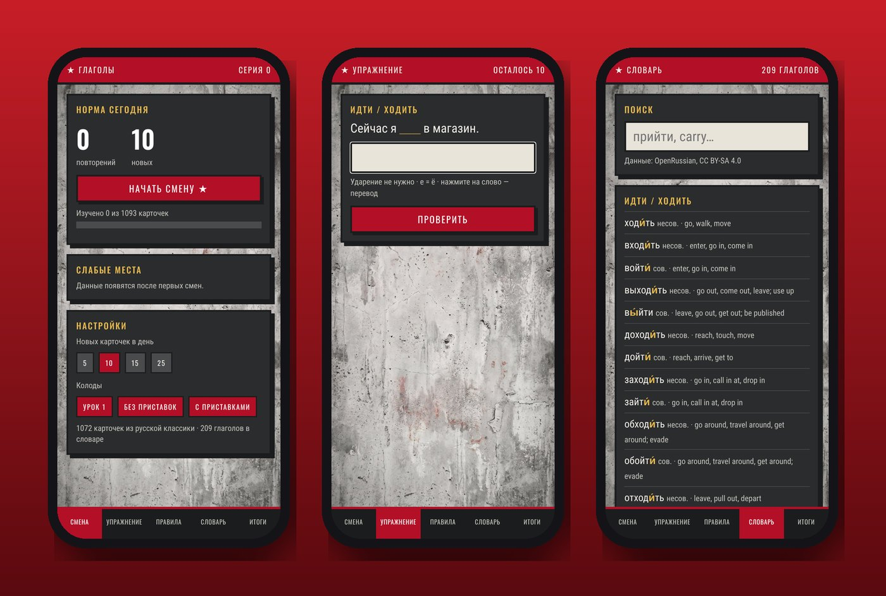
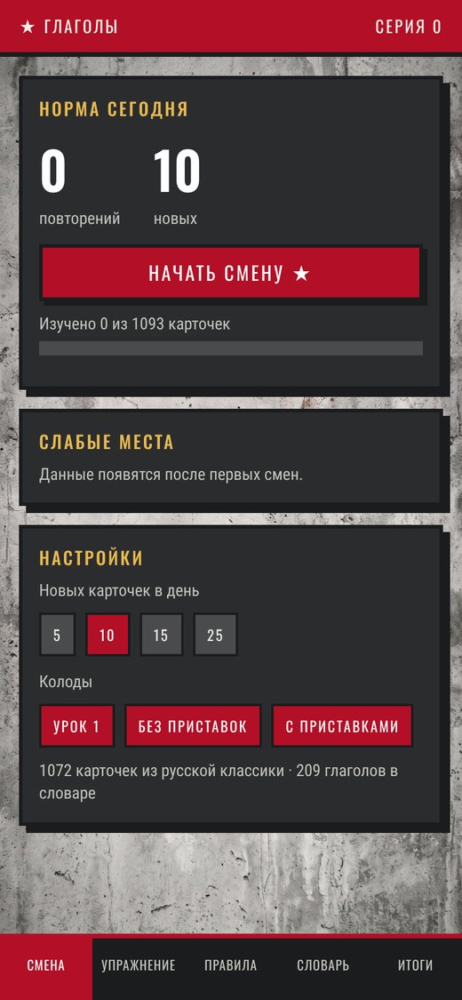
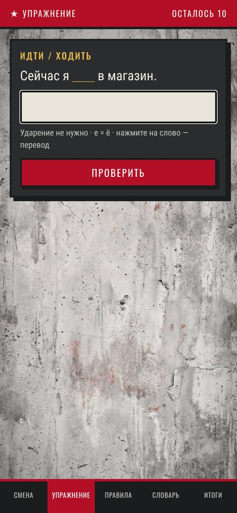
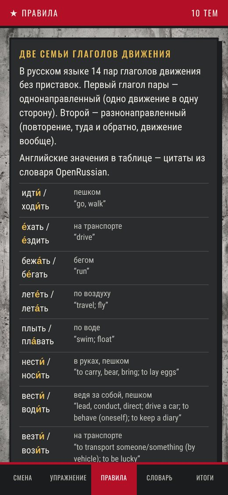

<h1 align="center">Russian Verbs (Глаголы)</h1>

<em>Master Russian verbs of motion with sentences from the great Russian novels.</em>

<a href="https://joshp523.github.io/russian/"><b>▶ Open the app</b></a>

Russian verbs of motion (*to go* on foot or by vehicle, once or regularly, *to carry*, *to lead*, and all their prefixes) are famously hard. This app drills them with real sentences from Pushkin, Gogol, Tolstoy, Dostoevsky, Chekhov and more: fill in the missing verb, then see the original line and its source.

## What you can do

- **Daily shift:** a set number of review and new cards each day (5, 10, 15 or 25).
- **Fill in the blank:** the hint shows the verb pair and the form needed. If you pick the other verb of the pair, it tells you the author chose differently and lets you try again.
- **Tap any word** in a quote for its dictionary form, stress, grammar and English meaning.
- **Rules:** 10 short lessons, each illustrated with quotes from the classics.
- **Dictionary:** 209 verbs of motion with full conjugation tables.
- **Progress:** spaced repetition, so the cards you miss come back sooner.

<table><tr><td align="center" valign="top"> Today's shift</td><td align="center" valign="top"> An exercise</td><td align="center" valign="top"> The rules</td></tr></table>
## Why it's worth a look

- **Cool:** You learn Russian grammar from Tolstoy and Dostoevsky, not from a textbook robot.
- **Innovative:** Over 1,000 practice cards were built from real literature, and every word is tap-to-translate.
- **Impressive:** 209 verbs, 21 classic works, stress marks everywhere, and it works with no internet connection.
- **Useful:** Ten minutes a day on the bus is enough. It remembers what you struggle with and brings it back at the right time.

Dictionary data from OpenRussian (CC BY-SA 4.0). Literary texts are in the public domain.

---

### On your phone
Open the link in Safari (iPhone/iPad) or Chrome (Android), then choose **Share → Add to Home Screen**. It gets its own icon and opens full-screen, just like an app from the store.

### More apps by Josh Riley
[The Riley Rag](https://joshp523.github.io/RileyRag/) · [QuipRash](https://joshp523.github.io/Quip-game-app/) · [Word Games](https://joshp523.github.io/Word-Games/) · [Riley Rangers](https://joshp523.github.io/Rangers-app/) · [Habits: Josh](https://joshp523.github.io/daily-discipline/) · [Habits: Meishe](https://joshp523.github.io/Habit-tracker-app-Meishe/) · [Habits: Grandma](https://joshp523.github.io/wendys-app/) · [Writing](https://joshp523.github.io/writing-app/)

Built by Josh Riley. Setup notes for whoever maintains it are in [SETUP.md](SETUP.md).
